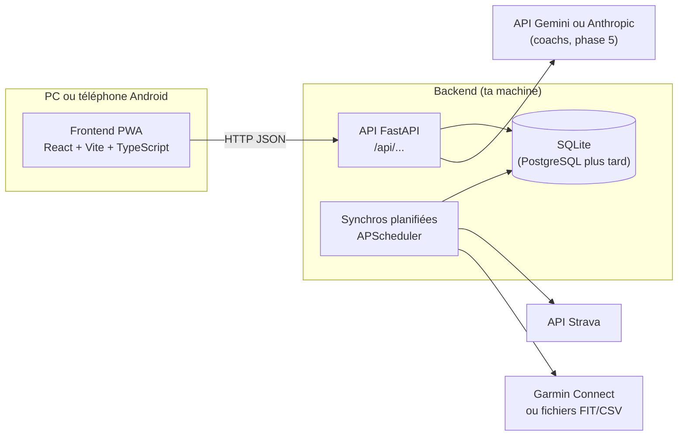
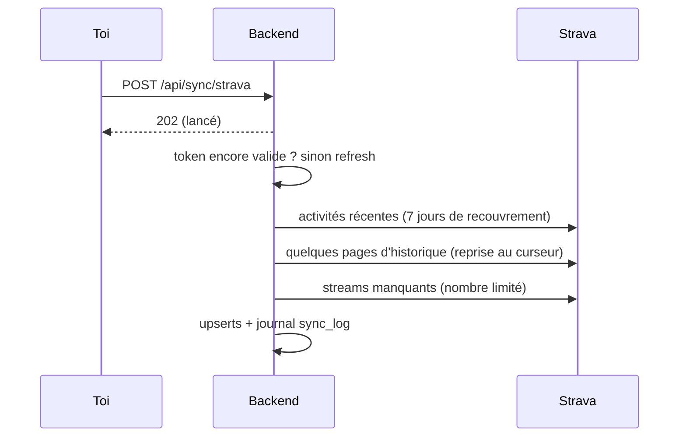

# Architecture

## Vue d'ensemble

Le **frontend** est une seule base de code pour PC et Android : c'est une application web
installable (PWA). Il ne parle qu'au **backend**, jamais directement à Strava ou Garmin, pour que
les clés secrètes restent côté serveur.

## Backend (`backend/`)

Le code est découpé en couches. Chaque couche ne parle qu'à celle d'en dessous :

| Couche | Dossier | Rôle |
|---|---|---|
| Routes | `app/api/` | Reçoit la requête HTTP, valide les entrées, renvoie la réponse. Aucune logique métier. |
| Services | `app/services/` | La logique : synchroniser, calculer, décider. |
| Accès aux données | `app/repositories/` | Lire et écrire en base. |
| Intégrations | `app/integrations/` | Clients Strava et Garmin. |

Pourquoi ce découpage : on peut tester la logique sans serveur HTTP, et changer de base de données
ou de source de données sans tout réécrire.

Base de données : modèles dans `app/db/models/`, migrations dans `alembic/`, détail dans
[data-model.md](data-model.md).

### Synchronisation Strava

### Données de santé

`HealthDataProvider` est un contrat commun à toutes les sources de santé. Garmin (bibliothèque non
officielle) et l'import de fichiers le respectent ; le reste de l'app ne connaît que le contrat.
Si Garmin casse, seule sa synchro échoue.

### Synchronisations planifiées

APScheduler tourne dans le processus du backend et lance toutes les `SYNC_INTERVAL_HOURS` heures
la synchro de chaque source configurée. Un échec sur une source n'empêche pas les autres.

Fichiers transverses :
- `app/config.py` : tous les réglages, lus depuis `.env`.
- `app/logging_config.py` : journaux, avec masquage automatique des secrets.

## Frontend (`frontend/`)

| Dossier | Rôle |
|---|---|
| `src/api/` | Tous les appels au backend, typés |
| `src/pages/` | Une page par écran (Accueil, Sources), routées avec React Router |
| `src/utils/` | Formatage (dates en heure de Luxembourg, libellés français) |
| `src/styles/` | Thème clair et sombre (variables CSS) |
| `src/App.tsx` | Composant racine |
| `e2e/` | Tests de bout en bout Playwright |

## Qualité

La CI GitHub (`.github/workflows/ci.yml`) lance sur chaque PR : lint, vérification des types,
tests unitaires, build du frontend, puis un test de bout en bout dans Chromium.
