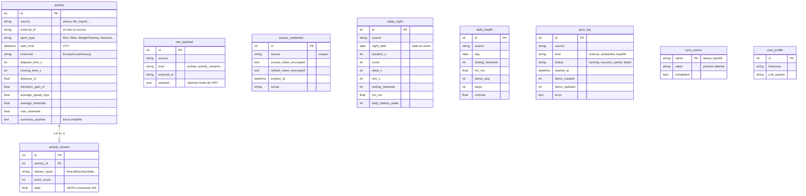

# Modèle de données

Schéma créé par la migration Alembic initiale (`backend/alembic/versions/`). Les modèles Python sont
dans `backend/app/db/models/`. Les tables des phases suivantes (objectifs, musculation, course,
coachs) arriveront avec leur propre migration.



## Règles

- **Pas de doublons** : contrainte unique `(source, external_id)` sur `activity`, `(source, night_date)`
  sur `sleep_night`, `(source, day)` sur `daily_health`, `(source, kind, external_id)` sur
  `raw_payload`. Les écritures sont des « upserts » (insère ou met à jour).
- **Unités SI** en base (secondes, mètres, m/s). Conversion en km, min/km, km/h à l'affichage.
- **Dates en UTC** (type `UTCDateTime`), affichées en heure de Luxembourg par le frontend.
- **Données brutes** dans `raw_payload`, séparées des tables normalisées : on peut tout reconstruire
  sans rappeler l'API.
- **Tokens chiffrés** (Fernet) dans `source_credential` ; la clé est dans `.env`, jamais en base.
- **Streams compacts** : un seul blob compressé par activité plutôt qu'une ligne par seconde
  (une sortie d'une heure = environ 3 600 points par série).

## Commandes

```bash
make db-upgrade                      # appliquer les migrations
make db-revision m="add goal table"  # générer une migration après avoir modifié un modèle
```

Le test `backend/tests/test_migrations.py` échoue si un modèle change sans migration.
