# Modèle de données

Schéma créé par les migrations Alembic (`backend/alembic/versions/`). Les modèles Python sont
dans `backend/app/db/models/`. Les tables des phases suivantes (course, coachs) arriveront avec
leur propre migration.

```mermaid
erDiagram
    activity ||--o| activity_stream : "a (0 ou 1)"
    place |o--o{ activity : "lieu (sans GPS)"
    activity |o--o| strength_session : "même séance (lien optionnel)"
    strength_session ||--|{ strength_set : contient
    activity {
        int id PK
        string source "garmin, strava, synthetic..."
        string external_id "id chez la source"
        string sport_type "Strava: Run, Workout... Garmin: running, strength_training..."
        datetime start_time "UTC"
        string timezone "Europe/Luxembourg"
        int elapsed_time_s
        int moving_time_s
        float distance_m
        float elevation_gain_m
        float average_speed_mps
        float average_heartrate
        float max_heartrate
        text summary_polyline "tracé simplifié"
        string category_override "correction manuelle : strength, cardio, transport, other"
        string garmin_activity_id "id Garmin (aussi lu dans l'external_id Strava)"
        int duplicate_of_id FK "activité Garmin dont c'est la copie"
        string duplicate_status "confirmed, possible"
        bool hidden "masquée à la main"
        int place_id FK "lieu choisi à la main (séance sans GPS)"
        bool excluded_from_race "exclue du prédicteur de course à la main"
        string location_name "ville donnée par la source"
        float start_latitude "point de départ"
        float start_longitude
    }
    place {
        int id PK
        string name "ex. Jims Gare"
        string city "ville affichée dans les listes"
        float latitude
        float longitude
        string role "strength_default, other_default (unique)"
    }
    activity_stream {
        int id PK
        int activity_id FK
        string stream_types "time,latlng,heartrate..."
        int point_count
        blob data "JSON compressé zlib"
    }
    raw_payload {
        int id PK
        string source
        string kind "activity, activity_streams..."
        string external_id
        json payload "réponse brute de l'API"
    }
    source_credential {
        int id PK
        string source "unique"
        text access_token_encrypted
        text refresh_token_encrypted
        datetime expires_at
        string scope
    }
    sleep_night {
        int id PK
        string source
        date night_date "date du réveil"
        int duration_s
        int score
        int deep_s
        int rem_s
        int resting_heartrate
        float hrv_ms
        int body_battery_wake
    }
    daily_health {
        int id PK
        string source
        date day
        int resting_heartrate
        float hrv_ms
        int stress_avg
        int steps
        float vo2max
        int intensity_moderate_min "Garmin, toute la journée"
        int intensity_vigorous_min "compte double dans le total"
        int floors_ascended "étages montés (Garmin, arrondis)"
        int floors_descended "étages descendus"
    }
    sync_log {
        int id PK
        string source
        string kind "manual, scheduled, backfill"
        string status "running, success, partial, failed"
        datetime started_at
        int items_created
        int items_updated
        text error
    }
    sync_cursor {
        string name PK "strava_backfill"
        string value "position atteinte"
        bool completed
    }
    user_profile {
        int id PK "toujours 1"
        string timezone
        string unit_system
        float height_cm
        string sex
        date birth_date "l'âge est calculé"
        int max_heartrate
        int resting_heartrate
        string experience_level
        text injuries
        date smoke_free_since "date d'arrêt de la cigarette (vide = 1er sept. 2026)"
    }
    race_target {
        int id PK
        string name
        float distance_m
        date race_date "jour local"
        int target_time_s "vide = pas de temps visé"
        float elevation_gain_m "0 = plat"
    }
    smoking_day {
        int id PK
        date day "unique : un jour local avec cigarette"
        int cigarettes "1 à 60"
        string note
    }
    body_metric {
        int id PK
        date measured_on "unique : une mesure par jour"
        string source "manual, synthetic"
        float weight_kg
        float body_fat_pct
        float waist_cm
    }
    strength_session {
        int id PK
        datetime performed_at "UTC"
        int duration_min
        text notes
        int activity_id FK "unique, optionnel"
    }
    strength_set {
        int id PK
        int session_id FK
        int position "ordre dans la séance"
        string exercise "nom en français"
        int set_number "1, 2, 3... par exercice"
        int reps
        float weight_kg "vide = poids du corps"
        int rpe "effort ressenti, 1 à 10"
    }
    goal {
        int id PK
        string kind "strength_sessions, cardio_sessions, active_minutes, distance_km, training_load, intensity_minutes, steps (par jour), floors"
        float target "par semaine"
        string sport "run, ride (objectifs en km)"
        date start_date
        date end_date
        string status "active, paused, done"
    }
```



## Règles

- **Pas de doublons** : contrainte unique `(source, external_id)` sur `activity`, `(source, night_date)`
  sur `sleep_night`, `(source, day)` sur `daily_health`, `(source, kind, external_id)` sur
  `raw_payload`. Les écritures sont des « upserts » (insère ou met à jour).
- **Unités SI** en base (secondes, mètres, m/s). Conversion en km, min/km, km/h à l'affichage.
- **Dates en UTC** (type `UTCDateTime`), affichées en heure de Luxembourg par le frontend.
- **Données brutes** dans `raw_payload`, séparées des tables normalisées : on peut tout reconstruire
  sans rappeler l'API.
- **Tokens chiffrés** (Fernet) dans `source_credential` ; la clé est dans `.env`, jamais en base.
- **Catégorie d'une activité** : calculée à partir de `sport_type` (`app/services/classification.py`),
  sauf si `category_override` est rempli. Les synchros ne touchent jamais cette colonne. La marche et
  les sorties vélo de moins de 5 km (hors home trainer) sont `transport` (« Déplacement ») : elles
  comptent dans la charge, mais dans aucun objectif de séances, de minutes ou de kilomètres.
- **Coachs IA** : `coach_conversation` et `coach_message` (blocs de contenu au format de l'API,
  en JSON) gardent les discussions ; `coach_memory` les faits retenus (`proposed` par le coach,
  `accepted` par FRANKS : seuls ceux-là sont envoyés au modèle) ; `coach_call` journalise chaque
  appel (modèle, jetons, coût en euros, latence, outils) et sert au budget du mois ;
  `coach_plan` les plans de semaine proposés par le coach (`proposed`, puis `accepted`, `rejected`
  ou `replaced` : un seul plan accepté par semaine, affiché sur l'Accueil ; il reste si la
  conversation est supprimée).
- **Tabac** : seuls les jours avec cigarette sont enregistrés (`smoking_day`) ; tous les autres jours
  depuis `smoke_free_since` comptent comme sans cigarette.
- **Pas de double comptage** : une séance saisie compte seule pour les objectifs seulement si elle
  n'est pas liée à une activité et qu'aucune activité de musculation n'a commencé à moins de 3 h.
- **Garmin d'abord, Strava en complément** (`app/services/dedupe.py`) : une activité Strava qui
  existe aussi dans Garmin (même id Garmin, ou début à moins de 10 min et durée à moins de 20 %)
  est marquée `duplicate_status = "confirmed"` et n'apparaît plus nulle part. S'il y a plusieurs
  candidates, elle est `"possible"` : les deux restent visibles et l'utilisateur peut en masquer
  une (`hidden`). Rien n'est supprimé, et si Garmin casse, les activités Strava comptent à nouveau.
- **Semaines** : du lundi 00 h au lundi suivant 00 h, heure de Luxembourg, converties en UTC pour
  interroger la base.
- **Streams compacts** : un seul blob compressé par activité plutôt qu'une ligne par seconde
  (une sortie d'une heure = environ 3 600 points par série).

## Commandes

```bash
make db-upgrade                      # appliquer les migrations
make db-revision m="add goal table"  # générer une migration après avoir modifié un modèle
```

Le test `backend/tests/test_migrations.py` échoue si un modèle change sans migration.
