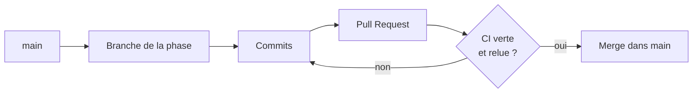

# GitHub pour ce projet, pas à pas

## Le vocabulaire en 6 mots

| Mot | Ce que c'est |
|---|---|
| **Dépôt** (repository) | Le dossier du projet, avec tout son historique. Le tien : `quen9669/App_Sport`. |
| **Commit** | Une photo du code à un instant, avec un message qui dit ce qui a changé. |
| **Branche** | Une ligne de travail parallèle. `main` est la version de référence ; on travaille ailleurs pour ne pas la casser. |
| **Pull Request (PR)** | Une demande pour fusionner une branche dans `main`. C'est là qu'on relit et qu'on discute. |
| **CI** | Les vérifications automatiques lancées par GitHub sur chaque PR (tests, lint…). |
| **Merge** | La fusion : les changements de la branche rejoignent `main`. |

## Notre façon de travailler



1. Je crée une branche pour la phase et j'y fais des commits.
2. J'ouvre une PR et je te mets en relecteur.
3. GitHub lance la CI. Attends la **coche verte** ✅. Une croix rouge ❌ veut dire qu'un test ou une
   vérification a échoué : je corrige.
4. Tu relis, puis tu fusionnes.

## Relire une PR

1. Ouvre la PR (lien dans le fil du projet, ou onglet **Pull requests** du dépôt).
2. Onglet **Conversation** : la description explique quoi et pourquoi.
3. Onglet **Commits** : la liste des étapes, une par commit.
4. Onglet **Files changed** : le détail. En vert ce qui est ajouté, en rouge ce qui est supprimé.
   - Survole une ligne et clique sur le **+** bleu pour laisser un commentaire ou poser une question.
   - Coche **Viewed** sur un fichier pour te souvenir que tu l'as lu.
5. En haut à droite, **Review changes** : choisis
   - **Comment** pour une question,
   - **Approve** si c'est bon,
   - **Request changes** si quelque chose doit être corrigé.

Ne t'inquiète pas de tout comprendre : pose tes questions directement sur les lignes, c'est fait pour.

## Fusionner

En bas de l'onglet Conversation, quand la CI est verte, clique sur **Merge pull request** puis
**Confirm merge**. Tu peux ensuite cliquer sur **Delete branch** : la branche a fini son travail.

## Récupérer le code sur ton PC (WSL2)

```bash
cd ~/App_Sport
git switch main      # se placer sur main
git pull             # récupérer les dernières modifications de GitHub
make install         # mettre à jour les dépendances si elles ont changé
```

## Lire un message de commit

On suit la convention **Conventional Commits** : `type(zone): description`.

| Type | Sens |
|---|---|
| `feat` | Nouvelle fonctionnalité |
| `fix` | Correction de bug |
| `test` | Ajout ou modification de tests |
| `docs` | Documentation |
| `build` / `ci` | Outils de build / intégration continue |
| `chore` | Entretien divers |

Exemple : `feat(backend): add FastAPI skeleton with health endpoint`.
